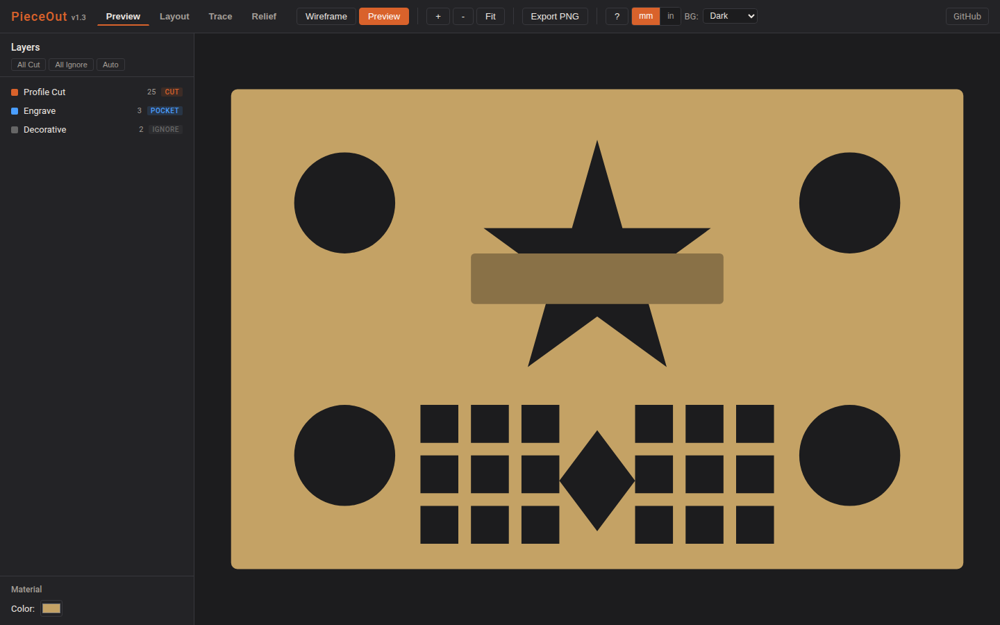
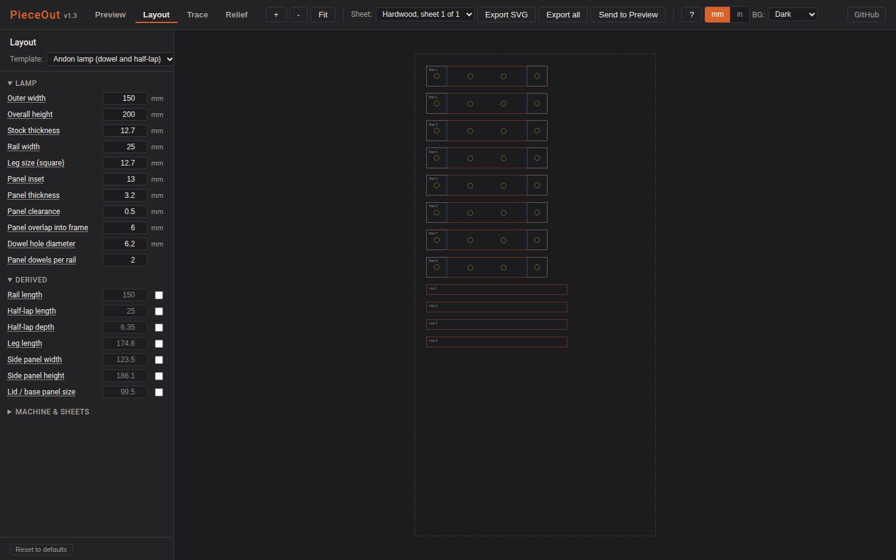
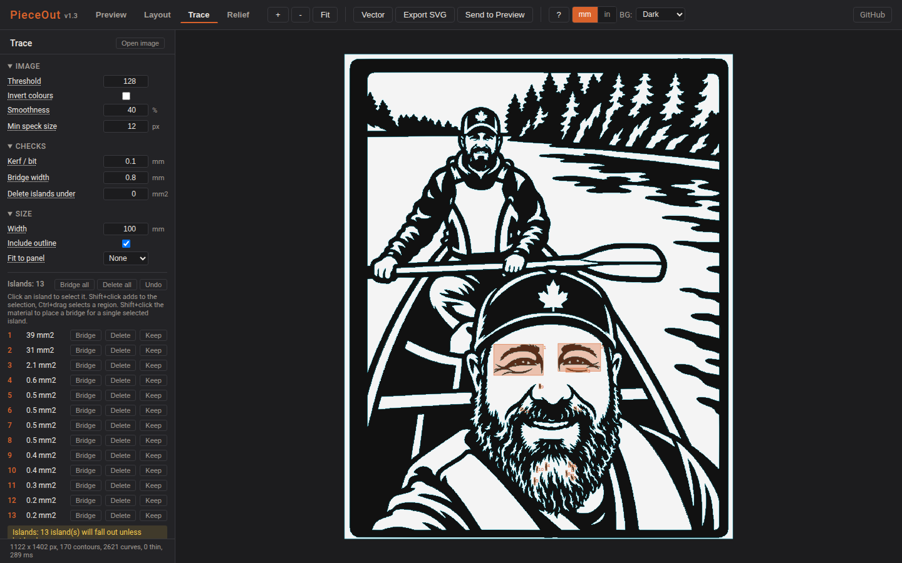

# PieceOut

**Preview what your CNC will actually cut, before you cut it.**

Drop in an SVG (e.g. exported from Vectric), tell PieceOut which layers are profile cuts, pockets, or decoration, and get an instant visual of the finished piece. No install, no build step, runs in your browser.

https://github.com/user-attachments/assets/58ff067c-7a4c-46cc-a53a-e39b67bd0832

---

## What it does

1. **Drag in an SVG.** Every `<g>` layer is parsed (Vectric, Inkscape, anything that uses grouped layers).
2. **Auto-classify** each layer as `CUT`, `POCKET`, or `IGNORE` based on layer-name keywords (`profile`, `pocket`, `engrave`, etc.). You can override any of them.
3. **See the result.** Preview mode renders cut paths punched out of a wood-colored material, with pockets shaded as recessed regions. Wireframe mode shows the raw geometry.
4. **Export a PNG** of the preview for documentation, client approval, or just remembering what you were planning.



Every control in the sidebars has hover help, and the `mm` / `in` toggle in the header shows all sizes in millimetres or decimal inches. Exported SVG files are always in millimetres, which Aspire and every other CAM reads without setup.

## Layout tab: generate cut files from dimensions

Switch to the **Layout** tab to go the other direction: type in the dimensions of a piece and get true-size, nested SVG cut files back, ready for Vectric Aspire (or any CAM that imports SVG by layer).

The first template is a Japanese Andon-style lamp: half-lapped square frames pinned with dowels, four legs, and basswood panels held by split dowels.



1. Enter the lamp dimensions (outer width, height, stock thickness, rail width, and so on). Derived sizes such as leg length and panel size update live, and any of them can be overridden.
2. Set your bit diameter, gutter, edge margin, and sheet sizes once. They are remembered.
3. Parts are nested per material onto sheets. Grain direction is respected: legs and rails never rotate.
4. **Export SVG** downloads the sheet you are looking at, one file per material per sheet. Layers are named for the operation: `CUT`, `POCKET-6.35mm`, `DRILL-6.2mm`, and `GUIDE` (reference only). Assign one toolpath per layer in Aspire and you are done.
5. **Send to Preview** drops the sheet into the Preview tab so you can see the cut before you leave the browser.

At assembly, every rail is cut identically, but each frame needs two of its four rails with the half-lap facing the bottom. Flip those rails END OVER END (rotate about the rail's width axis), never roll them about the long axis. Flipping end over end keeps the outer edge outward, and the panel dowel holes are symmetric about the rail centre so the hole pattern still lines up. Rolling a rail about its long axis would put the panel holes at `railWidth - panelInset` from the outer edge instead, which will not match the other rails in the frame.

All geometry is true part geometry. Tool offsets, tabs, and feeds stay in your CAM software where they belong.

## Trace tab: image to cut file, with island warnings

The **Trace** tab turns a black and white image into a smooth vector cut file without leaving the browser. Black is the material that stays, white is what the laser removes.



1. Open or drop a PNG, JPG, or WebP. Adjust threshold, invert colours (for white-on-dark art, or to cut the negative of a design), smoothness (how far the curves may stray from the pixels), and the speck size to ignore. Threshold is a single brightness cutoff (0 to 255), so a logo with grey or coloured elements on a dark background needs it lowered (around 60) before everything brighter than the background counts as a cut. Clean line art traces best; JPEG compression noise shows up as ragged edges.
2. Every **island** (a black piece not connected to the border) is boxed in red and numbered. Islands fall out after cutting. Click **Bridge** to connect one to the body across the shortest gap at the width you set, **Delete** to drop it, or **Bridge all**. Bridges survive threshold changes; **Undo** steps back.
3. Anything narrower than your kerf is boxed in orange.
4. Set the width in mm, or pick a panel from the Layout tab and the art is fitted to that panel's safe area.
5. **Vector** shows the finished cut; **Export SVG** downloads it with `CUT` and `GUIDE` layers; **Send to Preview** opens it in the Preview tab.

The tracer is written from scratch (contour following plus cubic Bezier fitting) so the repo stays MIT and dependency free.

## Generate tab: prompt or sketch to panel artwork

The optional **Generate** tab asks an image model for black and white panel artwork, then hands the result straight to Trace. Type what you want, optionally add a rough sketch or photo for the design to follow, pick a provider and press Generate.

- **Style profile.** A saved preamble plus up to four pinned style reference images are sent with every request, whichever provider you pick. That is what keeps a set of panels looking like a set. Edit it under **Style profile** in the sidebar; it is stored on the server, not in the browser.
- **Providers.** `ChatGPT (Codex login)` uses the official Codex CLI signed in with your own ChatGPT subscription; PieceOut never reads or stores a token. `Gemini` uses a Google AI Studio API key. `Local model` talks to any OpenAI compatible image server (for example stable-diffusion.cpp), which is free but can take many minutes per image on modest hardware.
- **Send to Trace** opens the result in the Trace tab for island checks, bridging and SVG export. **Download PNG** saves it.

Setup: copy `server/generate/.env.example` to `server/generate/.env`, fill in what you use, and restart the server. Providers that are not configured show as disabled with the reason. Keys stay on the server; the browser only ever talks to PieceOut. One generation runs at a time.

## Relief tab: image to recessed carving

The optional **Relief** tab creates a heightmap for carving artwork into the front face of material. Upload a PNG, JPEG, WebP or HEIC/HEIF photo, set width and maximum depth, generate AI depth, then adjust the carving area, shape and smoothing. HEIC photos from an iPad are converted automatically for preview. Preview the mask, shaded surface or grayscale heightmap and download a genuine 16-bit PNG plus physical size/settings for Aspire.

The surrounding face stays white (uncut); darker pixels represent deeper recesses. Transparent source areas and optional grayscale masks protect the face. Depth-based background removal needs visual checking: it does not automatically identify vines or other subjects.

**AI depth** shows estimated camera distance (lighter is nearer). **Export heightmap** shows the processed carving (white is the untouched face, darker is deeper), after your carving-area and shape adjustments. The browser shows 8-bit previews; use **Download 16-bit PNG** for the full-precision export. See [what each Relief view means](services/relief/README.md#what-the-preview-views-mean).

Relief uses an optional local NVIDIA GPU service. The existing three tabs remain browser-only and dependency-free. Start the service with:

```bash
docker compose -p pieceout-relief -f services/relief/compose.yaml up -d --build
```

Then run `node serve.js` as usual. See the [Relief setup and workflow](services/relief/README.md) for GPU selection, saved jobs, CLI usage and Aspire checks. Relief controls reuse saved depth rather than running AI again.

## Why

It was tedious to have to double-click every piece I wanted cut-out in the preview. With really intricate cuts this used to take a lot of time, and if you messed it up, you only had one `undo.` PieceOut gives you the ability to instantly see everything cut out, allowing you to identify any issues.

## Try it

```bash
node serve.js
# then open http://localhost:8765 in any modern browser
```

Drag-and-drop `test-sample.svg` (included) to see it work, or use any SVG with grouped layers.

No package manager, no build step, zero dependencies: just plain ES6 modules served by a tiny built-in Node HTTP server.

## Keyboard shortcuts

| Key | Action |
|-----|--------|
| `W` | Wireframe view |
| `F` | Preview (filled) view |
| `V` | Toggle raster/vector on the Trace tab |
| `+` / `-` | Zoom |
| `0` | Fit to viewport |

Mouse wheel zooms; click-drag pans; pinch + one-finger pan work on touch devices.

## How it works

Vanilla JS modules, loaded directly as ES6 modules from `index.html`:

- **[`js/svgParser.js`](js/svgParser.js)**: DOMParser-based SVG parsing. Extracts layers from `<g>` elements via `inkscape:label` or `id`. Collects all shape primitives (path / polygon / rect / circle / ellipse / line) per layer.
- **[`js/layerTagger.js`](js/layerTagger.js)**: keyword-based auto-classification with localStorage-persisted overrides.
- **[`js/renderer.js`](js/renderer.js)**: the visualization engine. Preview mode uses an SVG `<mask>` with `fill-rule="evenodd"` to punch CUT paths out of a material rectangle (handles complex outer-with-inner-cutouts geometry correctly). Pocket layers render as a darkened overlay.
- **[`js/viewport.js`](js/viewport.js)**: zoom/pan via viewBox manipulation. Mouse + touch.
- **[`js/app.js`](js/app.js)**: orchestrator. State, file upload, view modes, PNG export.
- **[`js/units.js`](js/units.js)**: the mm / inch display toggle. Pure conversion and formatting; every tab keeps its state in millimetres and converts only what is shown.
- **[`js/layout/`](js/layout/)**: the Layout tab. `templates/andonLamp.js` derives parts and joinery from lamp dimensions, `joints/` holds the half-lap and dowel-hole generators, `nest.js` packs parts onto sheets, `svgWriter.js` serialises a sheet to a true-size layered SVG, and `layoutUI.js` / `layoutForm.js` drive the sidebar. Everything below the UI is pure and unit-tested.
- **[`js/trace/`](js/trace/)**: the Trace tab. Pure raster pipeline (bitmap, components, contours, simplify, Bezier fit, thin features, bridging, SVG) plus the controller and overlay renderer.

- **[`js/relief/`](js/relief/)**: the Relief tab and same-origin API client. The optional Python/GPU service lives in [`services/relief/`](services/relief/).

## Tests

```bash
node --test
```

Uses Node's built-in test runner. The golden SVGs in `tests/fixtures/` are the default lamp's output; regenerate them with `node tests/fixtures/regen.js` after an intentional change to the template, nester, or writer. The Trace tab tests live in `tests/trace/`; regenerate fixtures with `node tests/trace/fixtures/regen.js`.

## Contributing

Issues and PRs welcome. The codebase is intentionally small and dependency-free. Please keep it that way unless there's a strong reason not to.

## License

[MIT](LICENSE) © Grooves-n-Grain
